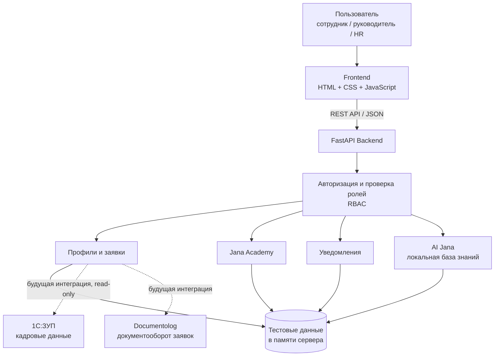

# Архитектура JanaMen

Схема того, как сейчас устроен наш MVP и куда в будущем можно подключить внешние HR-системы

## Что есть сейчас

- интерфейс и backend работают вместе через API
- сервер проверяет роль и доступ к данным, а не полагается только на скрытые кнопки
- используются тестовые пользователи, заявки, курсы и уведомления
- AI Jana ищет ответы в небольшой подготовленной базе знаний

## Что можно подключить позже

- **1С:ЗУП** — официальный источник Ф.И.О., должности, подразделения, даты приёма и остатка отпуска; данные в кабинете остаются только для чтения
- **Documentolog** — передача кадровых заявок, маршруты согласования и получение статусов документов
- **постоянная база данных** — чтобы заявки, решения, уведомления и обучение не сбрасывались после перезапуска
- **корпоративная авторизация** — вместо демонстрационных аккаунтов

Пунктир на схеме означает будущие интеграции. В текущей версии реальные 1С:ЗУП и Documentolog не подключены
